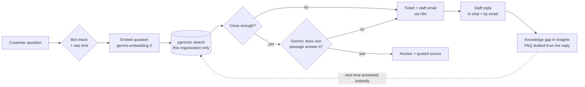

# OmniDesk AI

**Customer support that only answers from what a business has approved, and hands everything else to a person.**

**Live demo:** https://omnidesk-ai-one.vercel.app

OmniDesk is a multi-tenant support desk. A business adds its FAQs, policies, PDFs, or web pages, then shares a chat link or adds a chat button to its website with one script tag. Each question is answered from that approved knowledge, with the exact passage quoted. When nothing approved answers it, the question becomes a ticket and an email to the team, and the staff reply reaches the customer in the same chat. It never guesses.

**In one minute:**

- **Customers** ask without an account, get answers that cite their source, in their own language, and see staff replies in the same conversation.
- **Staff** work from a live dashboard: inbox, escalations with the full thread and a reply box, and email alerts.
- **Admins** manage knowledge (FAQ, text, PDF, web page), the team (admins and agents), the website widget, and see **Insights**: how much the AI answered, how fast staff replied, and which unanswered questions to turn into FAQs next.

<!-- Screenshot suggestion: docs/screenshots/chat.png (a grounded answer with its quoted source) -->

## How a question flows



1. **Retrieve by meaning.** The question is embedded and matched against the organization's passages with pgvector. "When do I get my money back?" finds the refund policy even though they share no words.
2. **Threshold.** If no passage is close enough, the question escalates without spending a model call.
3. **Judge, don't generate.** Gemini sees the top passages and must return structured JSON: whether one of them actually answers the question, the answer, and which passage it used. Sharing a topic is not enough.
4. **Cite or escalate.** Answers show the quoted passage they came from. Everything else opens a ticket, flags the conversation, and emails the organization's chosen contact.
5. **Close the loop.** Staff reply from the dashboard; the customer sees it in their chat and by email. Insights groups unanswered questions by meaning, and one click turns a group into an FAQ drafted only from what staff already replied.

## Measured, not assumed

`npm run eval` runs the production pipeline (chunking, embeddings, threshold, grounded answer) against a fixed fictional knowledge base and 30 questions with known right outcomes: direct questions, paraphrases with no shared words, Filipino questions, related-but-unanswered questions, off-topic questions, and a prompt injection.

<!-- EVAL_SUMMARY_START -->
| Metric | Result | |
|---|---|---|
| Overall accuracy | 30/30 | 100% |
| Answerable questions answered from the right source | 20/20 | 100% |
| Unanswerable questions correctly escalated | 10/10 | 100% |
| Retrieval recall (right source in top passages above threshold) | 20/20 | 100% |
| Wrong answers (answered when it should not, or from the wrong source) | 0 | none |

Last run 2026-11-17. Knowledge base: Harbor & Pine Outfitters (fictional), 5 sources, 11 passages. Embeddings: `gemini-embedding-2` (768 dimensions). Answers: `gemini-3.1-flash-lite`. Similarity threshold: 0.62. Passages per question: 6. Full per-question results: [evals/RESULTS.md](evals/RESULTS.md).
<!-- EVAL_SUMMARY_END -->

**Read these numbers with care.** The set is small (30 hand-written questions over 11 passages) and is a regression check, not a benchmark. Two questions ("Do you ship to Canada?", "Can I pay with Bitcoin?") were first labelled "should escalate", but the desk answered them correctly from exhaustive lists in the knowledge ("No, we only ship to the Philippines, Singapore, and Japan"), so they were relabelled. Every answer given is listed in the results file so you can judge for yourself.

The metric that matters most is **wrong answers**: a support desk that confidently answers from the wrong policy is worse than one that asks a person.

## Add it to any website

```html
<script src="https://omnidesk-ai-one.vercel.app/widget.js" data-desk="your-org" async></script>
```

A chat button appears in the corner and opens the desk in a panel. Optional attributes: `data-color="#0f62fe"`, `data-position="left"`, `data-label="Ask us"`. `window.OmniDesk.open()` opens it from your own buttons. The snippet, with these options filled in, is under **Dashboard → Organizations → Website widget**.

- The chat runs in an iframe from the OmniDesk domain, and the launcher's styles live in a shadow root, so the host site's CSS and the widget cannot break each other.
- Each organization can list the websites allowed to show its chat, enforced by the browser through a `Content-Security-Policy: frame-ancestors` header. Every other page, including the dashboard, refuses to be framed at all.
- The iframe loads on first open, so the widget costs the host page one small script until a visitor uses it.

## What is built

| Area | Details |
|---|---|
| **Tenant isolation** | Every table carries `organization_id`, enforced by Postgres row-level security, not just application code. Retrieval runs through a server-only database function scoped to one organization. |
| **Knowledge ingestion** | FAQ (split per question), text (paragraph/sentence chunking with overlap), PDF upload, and public web pages, all embedded on the server. Editing a source re-indexes it. |
| **Grounded answers** | Semantic retrieval, a similarity threshold, structured-output Gemini judging, and quoted citations. Keyword ranking is the fallback if embeddings are unavailable. |
| **Escalation** | A ticket and conversation flag in the same request, and an idempotent workflow event delivered to an n8n webhook that emails the organization's chosen recipient. The email layout is rendered and versioned in this repo. |
| **Staff replies** | Staff answer from the dashboard; the reply appears in the customer’s chat and is emailed if they left an address. Customers keep one thread across visits through a per-conversation token (only its hash is stored), and follow-ups never open duplicate tickets. |
| **Staff dashboard** | Overview, inbox, escalations with priority, status, and the full thread, knowledge management, automation log, and organizations. It updates live through Supabase Realtime. |
| **Abuse protection** | Cloudflare Turnstile on the public chat, Postgres-backed rate limits per visitor, per organization, and per outgoing email, and an SSRF guard on URL imports. |
| **Accounts** | Supabase Auth with email confirmation, password reset, and branded email templates. |
| **Teams** | Invite teammates as admins or agents. Invitation links are single use, only work for the invited email, and expire in 7 days. Role changes go through database functions that always keep at least one owner. |
| **Activity log** | Postgres triggers record knowledge edits, settings changes, membership changes, ticket updates, and staff replies with the acting user, so no code path can skip the log. |
| **Observability** | Sentry for errors, traces, and masked session replay, tunnelled through the app so ad blockers don't drop reports. Vercel Analytics for traffic. |
| **Insights** | Answered vs. handed-to-staff rates per day, median time to the first staff reply, helpful ratings, which sources answer the most questions, and **knowledge gaps**: unanswered questions grouped by meaning (embedding similarity), each one-click away from an FAQ that Gemini drafts only from what staff already replied. |
| **Tests** | 79 unit and database tests (`npm test`): chunking, the answer decision, the SSRF guard, and every migration applied to an in-memory Postgres with row-level security enforced, proving one organization can never read or change another's data. Plus Playwright browser tests of the public site and the website widget (`npm run test:e2e`). |
| **Quality gates** | ESLint (including Tailwind class rules), TypeScript, and the test suite on every push via GitHub Actions; a manual workflow runs the browser tests against production; the retrieval evaluation runs on demand. |

## Stack

- **App:** Next.js 16 (App Router, Cache Components), React 19, TypeScript, Tailwind CSS 4, GSAP, shadcn/ui
- **Data:** Supabase (Postgres, pgvector, Auth, Realtime, row-level security)
- **AI:** Google Gemini: `gemini-embedding-2` for retrieval, `gemini-3.1-flash-lite` for grounded answers (configurable with `GEMINI_MODEL`)
- **Automation:** n8n (escalation, staff-reply, and invitation emails, all rendered in this repo)
- **Testing:** Vitest, PGlite (in-memory Postgres with pgvector), Playwright
- **Platform:** Vercel (Sydney region, next to the database), Cloudflare Turnstile, Sentry

## Run it locally

Requirements: Node.js 22, a Supabase project, and a Gemini API key (the free tier is enough).

```bash
npm install
cp .env.example .env.local      # then fill in the values
npx supabase link --project-ref <your-project-ref>
npx supabase db push            # applies everything in supabase/migrations
npm run dev
```

Open http://localhost:3000, create an account, create an organization, add an FAQ, then open the organization's chat page and ask a question.

| Command | What it does |
|---|---|
| `npm run dev` | Development server |
| `npm run check` | Lint and type-check |
| `npm run build` | Production build |
| `npm run eval` | Retrieval and grounding evaluation (needs `GEMINI_API_KEY`); writes `evals/RESULTS.md` |
| `npm run eval:readme` | Copies the latest evaluation scores into this README |
| `npm run reindex` | Embeds knowledge that has no embeddings yet (run once after the retrieval migration) |
| `npm test` | Unit tests and database tests (row-level security, teams, insights) on an in-memory Postgres |
| `npm run test:e2e` | Playwright browser tests; set `BASE_URL` to test a deployed site, `E2E_DESK_HANDLE` to include the chat page and widget |

### Environment variables

[.env.example](.env.example) lists every variable, grouped into **config** (safe to expose; `NEXT_PUBLIC_*` values reach the browser) and **secrets** (server only). Optional services switch themselves off when their keys are missing: without Turnstile keys the bot check is skipped, without a Sentry DSN monitoring is off, and without an n8n webhook escalations still create tickets but send no email.

## Project structure

```
app/
  api/chat/                 public chat: bot check, rate limits, retrieval, answer or escalation
  api/chat/thread|contact|feedback/   a returning customer's thread, email, and answer ratings
  api/conversations/[id]/reply/       staff replies (saved with the staff member's session, then emailed)
  api/knowledge/            add, edit, and re-index knowledge sources (FAQ, text, PDF, web page)
  api/team/                 invitations and accepting them
  api/insights/draft-faq/   FAQ drafts from staff replies
  chat/[handle]/            public customer chat page (/chat/your-org-name)
  embed/[handle]/           the chat inside the website widget
  dashboard/                overview, inbox, escalations, knowledge, insights, automation,
                            organizations, team, activity
  invite/[token]/           invitation landing page
  auth/                     sign in, sign up, confirmation, password reset
  privacy/, terms/          legal pages
public/widget.js            the embeddable chat button (no dependencies, shadow DOM)
lib/server/ai/              chunking, embeddings, retrieval, grounding (shared with the eval)
lib/server/insights/        grouping unanswered questions into knowledge gaps
lib/server/                 rate limits, Turnstile, URL/PDF extraction, tokens, workflow emails
lib/email/                  escalation, reply, and invitation email templates
supabase/migrations/        schema, row-level security, database functions, audit triggers
supabase/templates/         branded auth emails
tests/unit/, tests/db/      Vitest unit tests and database tests (row-level security on PGlite)
e2e/                        Playwright browser tests
evals/                      evaluation knowledge base, test questions, latest results
```

## Roadmap

- [x] **Milestone 1: launch safely.** Bot check, rate limits, error monitoring, password reset, email confirmation, configurable escalation emails.
- [x] **Milestone 2: real retrieval.** Embeddings and pgvector, chunking, PDF and web page import, quoted citations, similarity threshold, evaluation set.
- [x] **Milestone 3: staff replies.** Reply from the dashboard, customers see replies in their chat (and by email), follow-up messages in one thread, ask for an email when a question escalates.
- [x] **Milestone 4: embeddable widget.** One script tag adds a chat button to any website, with brand colour, position, and an allowed-websites list.
- [x] **Milestone 5: teams.** Email invitations (single use, email-bound, 7-day expiry), owner/admin/agent roles enforced in the database and reflected in the UI, and a trigger-written activity log.
- [x] **Milestone 6: insights.** Answer vs. escalation rates, staff response time, answer ratings, and knowledge gaps grouped by meaning that turn into FAQs drafted from staff replies.
- [x] **Milestone 7: quality.** Unit tests, row-level-security tests on a real Postgres, Playwright browser tests, and CI.
- [x] **Launch checklist.** Privacy policy and terms, social preview image, favicon, sitemap and robots.txt, per-page titles and descriptions, security headers (HSTS and more), WCAG AA colour contrast, no horizontal scroll on phones, no broken links.

Possible next steps: AI-drafted staff replies, an email inbox channel, ticket assignment with response-time targets, and plans and usage limits.

## Security notes

- The service-role key, Gemini key, and webhook URL exist only on the server. The browser talks to Supabase with the public anon key, so row-level security governs everything it can read or write.
- Public endpoints verify a single-use Turnstile token (action and hostname checked) before any database write.
- Retrieval, rate limiting, and recipient lookup are `security definer` functions callable only by the service role.
- Customer conversations and team invitations use random tokens; only their SHA-256 hashes are stored.
- Security headers on every response (HSTS, nosniff, referrer and permissions policies); only the widget's embed page can be framed, and only by each organization's allowed websites.

---

A standalone portfolio project by [B1Kjuu](https://github.com/B1Kjuu). Example organizations shown on the landing page are illustrative.
