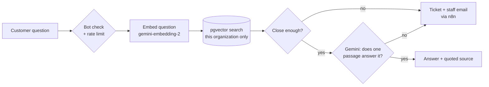

# OmniDesk AI

**Customer support that only answers from what a business has approved, and hands everything else to a person.**

**Live demo:** https://omnidesk-ai-one.vercel.app

OmniDesk is a multi-tenant support desk. A business adds its FAQs, policies, PDFs, or web pages and shares a chat link with customers. Each question is answered from that approved knowledge, with the exact passage quoted, or, when nothing approved answers it, turned into a ticket and an email to the team. It never guesses.

<!-- Screenshot suggestion: docs/screenshots/chat.png (a grounded answer with its quoted source) -->

## How a question flows



1. **Retrieve by meaning.** The question is embedded and matched against the organization's passages with pgvector. "When do I get my money back?" finds the refund policy even though they share no words.
2. **Threshold.** If no passage is close enough, the question escalates without spending a model call.
3. **Judge, don't generate.** Gemini sees the top passages and must return structured JSON: whether one of them actually answers the question, the answer, and which passage it used. Sharing a topic is not enough.
4. **Cite or escalate.** Answers show the quoted passage they came from. Everything else opens a ticket, flags the conversation, and emails the organization's chosen contact.

## Measured, not assumed

`npm run eval` runs the production pipeline (chunking, embeddings, threshold, grounded answer) against a fixed fictional knowledge base and 30 questions with known right outcomes: direct questions, paraphrases with no shared words, Filipino questions, related-but-unanswered questions, off-topic questions, and a prompt injection.

<!-- EVAL_SUMMARY_START -->
| Metric | Result | |
|---|---|---|
| Overall accuracy | 30/30 | 100% |
| Answerable questions answered from the right source | 20/20 | 100% |
| Unanswerable questions correctly escalated | 10/10 | 100% |
| Retrieval recall (right source in top passages above threshold) | 20/20 | 100% |
| Wrong answers (answered when it should not, or from the wrong source) | 0 | none |

Last run 2026-11-17. Knowledge base: Harbor & Pine Outfitters (fictional), 5 sources, 11 passages. Embeddings: `gemini-embedding-2` (768 dimensions). Answers: `gemini-3.1-flash-lite`. Similarity threshold: 0.62. Passages per question: 6. Full per-question results: [evals/RESULTS.md](evals/RESULTS.md).
<!-- EVAL_SUMMARY_END -->

**Read these numbers with care.** The set is small (30 hand-written questions over 11 passages) and is a regression check, not a benchmark. Two questions ("Do you ship to Canada?", "Can I pay with Bitcoin?") were first labelled "should escalate", but the desk answered them correctly from exhaustive lists in the knowledge ("No, we only ship to the Philippines, Singapore, and Japan"), so they were relabelled. Every answer given is listed in the results file so you can judge for yourself.

The metric that matters most is **wrong answers**: a support desk that confidently answers from the wrong policy is worse than one that asks a person.

## What is built

| Area | Details |
|---|---|
| **Tenant isolation** | Every table carries `organization_id`, enforced by Postgres row-level security, not just application code. Retrieval runs through a server-only database function scoped to one organization. |
| **Knowledge ingestion** | FAQ (split per question), text (paragraph/sentence chunking with overlap), PDF upload, and public web pages, all embedded on the server. Editing a source re-indexes it. |
| **Grounded answers** | Semantic retrieval, a similarity threshold, structured-output Gemini judging, and quoted citations. Keyword ranking is the fallback if embeddings are unavailable. |
| **Escalation** | A ticket and conversation flag in the same request, and an idempotent workflow event delivered to an n8n webhook that emails the organization's chosen recipient. The email layout is rendered and versioned in this repo. |
| **Staff dashboard** | Overview, inbox, escalations with priority and status, knowledge management, automation log, and organizations. It updates live through Supabase Realtime. |
| **Abuse protection** | Cloudflare Turnstile on the public chat, Postgres-backed rate limits per visitor, per organization, and per outgoing email, and an SSRF guard on URL imports. |
| **Accounts** | Supabase Auth with email confirmation, password reset, and branded email templates. |
| **Observability** | Sentry for errors, traces, and masked session replay, tunnelled through the app so ad blockers don't drop reports. Vercel Analytics for traffic. |
| **Quality gates** | ESLint (including Tailwind class rules) and TypeScript on every push via GitHub Actions, plus the retrieval evaluation. |

## Stack

- **App:** Next.js 16 (App Router, Cache Components), React 19, TypeScript, Tailwind CSS 4, GSAP, shadcn/ui
- **Data:** Supabase (Postgres, pgvector, Auth, Realtime, row-level security)
- **AI:** Google Gemini: `gemini-embedding-2` for retrieval, `gemini-3.1-flash-lite` for grounded answers (configurable with `GEMINI_MODEL`)
- **Automation:** n8n (escalation emails)
- **Platform:** Vercel (Sydney region, next to the database), Cloudflare Turnstile, Sentry

## Run it locally

Requirements: Node.js 22, a Supabase project, and a Gemini API key (the free tier is enough).

```bash
npm install
cp .env.example .env.local      # then fill in the values
npx supabase link --project-ref <your-project-ref>
npx supabase db push            # applies everything in supabase/migrations
npm run dev
```

Open http://localhost:3000, create an account, create an organization, add an FAQ, then open the organization's chat page and ask a question.

| Command | What it does |
|---|---|
| `npm run dev` | Development server |
| `npm run check` | Lint and type-check |
| `npm run build` | Production build |
| `npm run eval` | Retrieval and grounding evaluation (needs `GEMINI_API_KEY`); writes `evals/RESULTS.md` |
| `npm run eval:readme` | Copies the latest evaluation scores into this README |
| `npm run reindex` | Embeds knowledge that has no embeddings yet (run once after the retrieval migration) |

### Environment variables

[.env.example](.env.example) lists every variable, grouped into **config** (safe to expose; `NEXT_PUBLIC_*` values reach the browser) and **secrets** (server only). Optional services switch themselves off when their keys are missing: without Turnstile keys the bot check is skipped, without a Sentry DSN monitoring is off, and without an n8n webhook escalations still create tickets but send no email.

## Project structure

```
app/
  api/chat/            public chat endpoint: bot check, rate limits, retrieval, answer or escalation
  api/knowledge/       add, edit, and re-index knowledge sources
  chat/[handle]/       public customer chat page (/chat/your-org-name)
  dashboard/           staff workspace
  auth/                sign in, sign up, confirmation, password reset
lib/server/ai/         chunking, embeddings, retrieval, grounding (shared with the eval)
lib/server/            rate limiting, Turnstile, URL/PDF extraction, error formatting
lib/email/             escalation email template
supabase/migrations/   schema, row-level security policies, database functions
supabase/templates/    branded auth emails
evals/                 evaluation knowledge base, test questions, latest results
```

## Roadmap

- [x] **Milestone 1: launch safely.** Bot check, rate limits, error monitoring, password reset, email confirmation, configurable escalation emails.
- [x] **Milestone 2: real retrieval.** Embeddings and pgvector, chunking, PDF and web page import, quoted citations, similarity threshold, evaluation set.
- [ ] **Milestone 3: staff replies.** Reply from the dashboard, customers see replies in their chat, follow-up messages, ask for an email when a question escalates.
- [ ] **Milestone 4: embeddable widget.** A script tag that adds the chat to any website.
- [ ] **Milestone 5: teams.** Invitations, roles in the UI, audit log.
- [ ] **Milestone 6: insights.** Answer vs. escalation rates, knowledge-gap suggestions from escalated questions, answer ratings.

## Security notes

- The service-role key, Gemini key, and webhook URL exist only on the server. The browser talks to Supabase with the public anon key, so row-level security governs everything it can read or write.
- Public endpoints verify a single-use Turnstile token (action and hostname checked) before any database write.
- Retrieval, rate limiting, and recipient lookup are `security definer` functions callable only by the service role.

---

A standalone portfolio project by [B1Kjuu](https://github.com/B1Kjuu). Example organizations shown on the landing page are illustrative.
